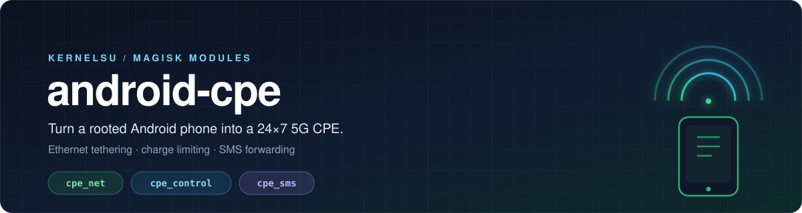
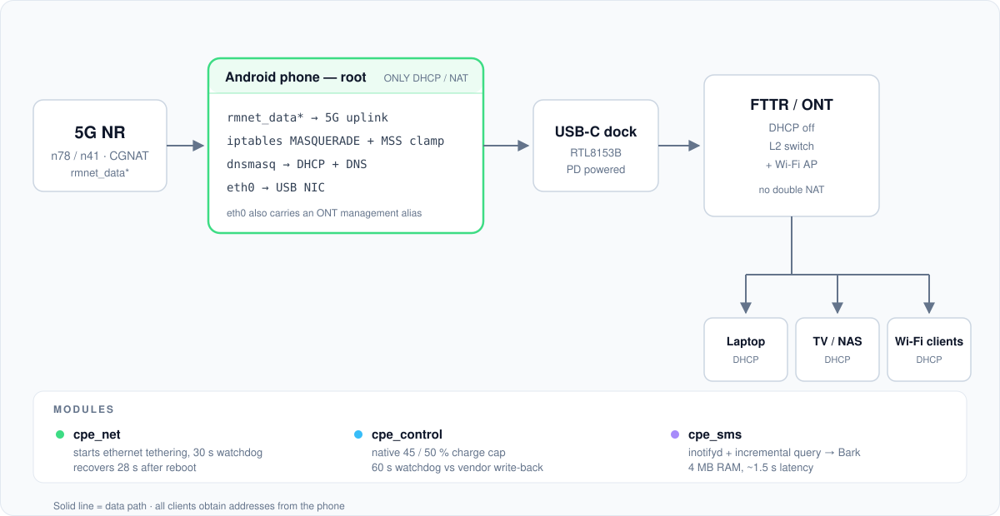

<div align="center">
  
</div>

<p align="center">
  <a href="#快速开始"></a>
  
  
  
  
  <a href="LICENSE"></a>
</p>

<p align="center">
  <b>把一台闲置 Android 手机做成 24×7 的 5G 有线 CPE。</b><br>
  不装第三方 App、不常驻 Java 进程、不依赖厂商保活——全部走 root + 系统原生能力。
</p>

---

Android 的「以太网网络共享」只有一个 UI 开关：没有 shell 命令、开机不自启、链路抖动一次就掉。这个仓库用三个 KernelSU / Magisk 模块把这条路补完。

| 你遇到的问题 | 模块 | 做法 |
|---|---|---|
| 共享开关**拉不起来**，重启后全屋断网 | [`cpe_net`](modules/cpe_net) | `app_process` + 反射调 `TetheringManager`，7 KB dex + 30 s 看门狗 |
| 长期插电**电池鼓包** | [`cpe_control`](modules/cpe_control) | 写内核原生 `chg_up_limit`，45 / 50 % 停充 |
| 手机当路由器后**收不到验证码** | [`cpe_sms`](modules/cpe_sms) | `inotifyd` 监听短信库 → Bark，4 MB 内存、~1.5 s 延迟 |

## 目录

- [架构](#架构)
- [模块](#模块)
  - [cpe_net — 以太网共享自动化](#cpe_net--以太网共享自动化)
  - [cpe_control — 限充 / 旁路供电](#cpe_control--限充--旁路供电)
  - [cpe_sms — 短信转发](#cpe_sms--短信转发)
- [快速开始](#快速开始)
- [硬件坑：拓展坞必须接 PD 供电](#硬件坑拓展坞必须接-pd-供电)
- [已知限制](#已知限制)
- [文档](#文档)
- [安全提醒](#安全提醒)

## 架构

<div align="center">
  
</div>

关键设计：**手机做全屋唯一的 DHCP / NAT 网关，光猫只做二层交换 + AP**。这样不依赖光猫是否支持电口上行，也避免双 NAT。

代价是手机成了单点——所以 `cpe_net` 的看门狗是必需品，不是加分项。设计取舍见 [docs/architecture.md](docs/architecture.md)。

## 模块

### cpe_net — 以太网共享自动化

Android 没有任何公开的 shell 入口能打开以太网共享：

```text
cmd tethering      → No shell command implementation
cmd ethernet       → No shell command implementation
cmd connectivity   → 没有 tethering 子命令
service call       → 只支持基本类型，传不了 Parcelable
uiautomator        → 要求屏幕已解锁，开机场景直接废
```

唯一可行的是以 root 身份跑一段 Java，直接调 `TetheringManager`：

```bash
CLASSPATH=/data/adb/modules/cpe_net/tetherctl.dex \
  app_process /system/bin cpecpe.TetherCtl start
# RESULT:STARTED
```

源码只有 200 行（[TetherCtl.java](modules/cpe_net/src/cpecpe/TetherCtl.java)），仓库里带预编译 dex。踩过的坑——Looper、`systemMain()`、`@SystemApi` 常量、错误码 18——全部记在 [docs/pitfalls.md](docs/pitfalls.md)。

> **实测**：手动停掉后自愈；重启后 **28 秒**自动恢复共享，全程不碰手机。

### cpe_control — 限充 / 旁路供电

```bash
# enable,upper,force,lower,callname
echo 1,50,1,45,2 > /sys/devices/virtual/oplus_chg/common/chg_up_limit
```

写入后由**内核自己的状态机**每 ~6 s 轮询：到 50 % 停充、掉到 45 % 复充，不需要用户态守护进程。模块只做两件事：开机重写（重启不保留）+ 60 s 看门狗压制 ColorOS 的写回。

50 % 时实测电芯电压 3.924 V 纹丝不动、`current_now=0`、`ibat=0`，同时 `usb/current_now=375 mA`——**充电器直供主板、电池隔离在回路外**，天然是 UPS。

> [!NOTE]
> 判据是 `current_now` 和电芯电压，不是状态栏图标。状态栏显示「正在充电」时电池可能并没有充。

### cpe_sms — 短信转发

```text
inotifyd 盯 mmssms.db
   ↓
sms_watch.sh（mkdir 锁，事件与兜底轮询互斥）
   ↓
content query --where "date > $last_date OR _id > $last_id"
   ↓
curl --data-urlencode POST https://api.day.app/push
```

三种形态的实测成本：

| 形态 | 常驻内存 | 空闲 CPU | 延迟 |
|---|---|---|---|
| 纯轮询 10 s | 0 | 2.5 % 单核 | ≤ 11 s |
| **inotifyd + 60 s 兜底（采用）** | **4 MB / 1 线程** | **0.4 % 单核** | **~1.5 s** |
| 常驻 Java（ContentObserver） | 78.5 MB PSS | ≈ 0 | < 0.5 s |

关键成本：`content query` 每次要起一个 ART 虚拟机（1.07 s 墙钟），所以事件触发远比轮询划算。

> [!IMPORTANT]
> 水位线必须用 `(date, _id)` 复合游标。SQLite 的 rowid 会复用已删除的最大 id，只用 `_id` 会漏转——这个坑实测踩过。

## 快速开始

### 前置条件

- 已 root 的 Android 11+ 设备（KernelSU 或 Magisk）
- USB-C 拓展坞 + **带 PD 供电口**
- 支持 USB3 的千兆网卡（RTL8153B / AX88179 等，内核需带驱动）

### 安装

```bash
# 每个模块都是一个标准的 KernelSU / Magisk 模块目录
adb push modules/cpe_net /data/local/tmp/
adb shell su -c 'cp -r /data/local/tmp/cpe_net /data/adb/modules/'
adb shell su -c 'chmod 755 /data/adb/modules/cpe_net/*.sh'

# 配置
adb shell su -c 'mkdir -p /data/adb/cpe'
adb shell su -c 'cp /data/adb/modules/cpe_net/net.conf.example /data/adb/cpe/net.conf'
adb shell su -c 'cp /data/adb/modules/cpe_sms/sms.conf.example /data/adb/cpe/sms.conf'
# 编辑 sms.conf，填入你的 BARK_KEY

adb reboot
```

重启后验证：

```bash
adb shell su -c 'sh /data/adb/modules/cpe_net/service.sh status'
adb shell su -c 'sh /data/adb/modules/cpe_sms/service.sh status'
```

### 重新编译 tetherctl.dex

```bash
export ANDROID_JAR="$ANDROID_HOME/platforms/android-36/android.jar"
export D8_JAR="$ANDROID_HOME/build-tools/30.0.3/lib/d8.jar"
./modules/cpe_net/build.sh
```

## 硬件坑：拓展坞必须接 PD 供电

不接供电时，网卡枚举成功、`eth0` 创建成功、驱动绑定成功、`ip link` 显示 UP，**但 `carrier` 永远是 0**，网口灯不亮。

原因：USB-C 单口供电不足以驱动千兆网卡的 PHY。接上 PD 供电线后 `carrier` 立刻变 1。

> [!WARNING]
> 这个坑极具迷惑性——所有软件层指标都「正常」，只有物理层起不来。排查时先看 `/sys/class/net/eth0/carrier`。

## 已知限制

| 限制 | 说明 |
|---|---|
| `cpe_control` 厂商专属 | 依赖 `oplus_chg` 节点，只适用于 OPPO / 一加。其他机型请参考 ACC 的 `charge_control_limit` |
| 自建 NAT 不能兜底 | 自己配 IP + dnsmasq + NAT 时回程走不通（高通 IPA 硬件卸载要求 fwmark 归属），所以核心是调起系统原生共享 |
| 共享网段会变 | ColorOS 每次重启重新随机分配网段，客户端必须走 DHCP，不能硬编码网关 |
| RCS / 5G 消息抓不到 | 它们不进 `content://sms` |
| 首次解锁前读不到短信 | FBE 加密，CE 存储不可用。关掉锁屏密码即可 |
| 不含引导镜像 | 备份与恢复方法见 [docs/field-notes.md](docs/field-notes.md)，动手前请自行备份 |

## 文档

| 文档 | 内容 |
|---|---|
| [docs/pitfalls.md](docs/pitfalls.md) | **踩坑总集**，按浪费时间的程度排序。本仓库最值钱的部分 |
| [docs/architecture.md](docs/architecture.md) | 链路设计、开机流程、两种共享模式 |
| [docs/field-notes.md](docs/field-notes.md) | 选点判据、热测试判据、旁路供电验证方法 |

```text
modules/
  cpe_net/          以太网共享自动化（源码 + 预编译 dex + 构建脚本）
  cpe_control/      限充 / 放电控制器
  cpe_sms/          短信 → Bark 转发
tools/              诊断脚本（接口统计、信号采样）
thermal/            热测试方案与采样脚本
docs/               设计文档、踩坑总集、实测方法论
```

## 安全提醒

> [!CAUTION]
> - 脚本会写 `iptables`、`sysfs` 和 `/data/adb`。**先在能救砖的设备上试。**
> - `discharge.sh` 会把 USB 输入限流设成 0 强制放电。虽然带三重熔断（目标电量 / 下限 / 超时），但**不要在有重要事务的机器上跑**。
> - 不要盲目刷入 `boot` 分区。

## 致谢

- [KernelSU](https://github.com/tiann/KernelSU) — 本项目的模块运行环境
- [Bark](https://github.com/Finb/Bark) — iOS 推送通道
- [ACC](https://github.com/VR-25/acc) — 充电控制的通用方案参考

## License

[MIT](LICENSE)。第三方固件（如 `rtl_nic/rtl8153b-2.fw`）不包含在仓库内，请从 [linux-firmware](https://git.kernel.org/pub/scm/linux/kernel/git/firmware/linux-firmware.git) 获取并遵守其许可。
